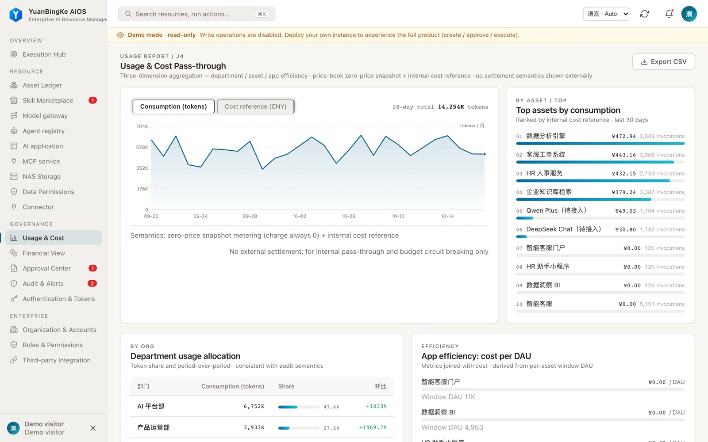

<p align="center">
  
</p>

<h1 align="center">元冰可 AIOS</h1>

<p align="center"><strong>让数字员工与企业 AI 能力，在统一治理下协同工作。</strong></p>
<p align="center">面向企业的 AI 运行与治理平台 · 支持自主部署 · 基于 dsh / cordis 插件体系</p>

<p align="center">
  <a href="https://github.com/01men/ybkkasi/actions/workflows/quality-gate.yml"></a>
  <a href="LICENSE"></a>
  <a href="https://nodejs.org/"></a>
</p>

<p align="center">
  <a href="https://demo.ybkkasi.com/"><strong>在线体验</strong></a> ·
  <a href="#快速开始">快速开始</a> ·
  <a href="#接入-dsh">接入 dsh</a> ·
  <a href="#面向-agent-和开发者">Agent 接入</a> ·
  <a href="docs/deploy-enterprise.md">部署指南</a>
</p>

[](https://demo.ybkkasi.com/)

## 一个面向协作与治理的 AI 平台

元冰可连接企业的目标、数字员工与 AI 能力，让任务执行、能力调用和交付验收有迹可循。数字员工是协作主体；MCP 服务、Skill、模型渠道和应用等是其可使用的能力与资源。

- **组织协作**：围绕目标、项目和任务组织数字员工的工作，支持受控调用与交付验收。
- **能力管理**：集中管理 MCP 服务、Skill、模型渠道、应用及连接器，支持资源生命周期和授权。
- **企业治理**：以组织、身份和权限约束访问，结合审批、审计和用量记录追踪操作。
- **灵活接入**：独立运行控制台与 API，也可通过 dsh 插件、MCP 和命令行接入。

## 快速开始

在线体验无需安装：[demo.ybkkasi.com](https://demo.ybkkasi.com/)。

本地使用 Docker Compose 启动一个只读演示实例：

```bash
git clone https://github.com/01men/ybkkasi.git
cd ybkkasi
docker compose up -d
```

打开 [http://localhost:7300](http://localhost:7300)。演示模式会让访客访问实例的只读数据，请仅在隔离的演示环境使用，不要接入真实业务数据。

如需从源码启动独立实例，需要 Node.js ≥ 22.6：

```bash
npm ci
npm start
```

独立实例默认不注入演示数据。首次启动凭据、持久化、备份和企业部署配置见[部署指南](docs/deploy-enterprise.md)。

## 接入 dsh

项目提供 dsh `web` profile 的插件包；仓库声明的兼容范围为 `>=0.1.0-rc.7 <0.2.0`。dsh 挂载仍属实验性接入，请先在隔离环境验证所用版本。

```bash
dsh plugin --profile web add github:01men/ybkkasi
```

挂载配置将控制台和 API 放在 dsh Web 服务的 `/rq` 前缀下。远程 dsh 也可通过一次性接入码连接已有平台，凭证与授权范围由管理员管理。接入和部署细节见[部署指南](docs/deploy-enterprise.md)。

## 面向 Agent 和开发者

| 入口 | 用途 |
| --- | --- |
| [llms.txt](llms.txt) | 项目概要、Agent 操作边界与文档索引 |
| [运维 Skill 索引](skills/dsh-ops-admin/SKILL.md) | 按领域查找运维手册；可直接读取或安装到 dsh 的 Skill 目录 |
| `POST /mcp` | 平台运维工具的 MCP 接口；工具列表按调用方权限过滤 |
| `GET /api/openapi.json` | 当前实例的 REST 接口描述，需要授权 |
| [命令行工具](cli/dshctl.mjs) | 平台运维 CLI，支持 `--output json` |

以上路径以独立实例为例；dsh 挂载形态使用 `/rq` 前缀。访问受保护接口时请使用获得授权的凭据。CLI 的 `--dry-run` 仅对明确支持预演的操作有效；其他写入会被拒绝。

## 运行边界

- **数据与可用性**：当前存储形态面向单进程运行，不应让多个进程同时使用同一数据目录；部署前请规划备份和恢复。
- **权限与凭据**：按需授予最小权限，妥善保管令牌、接入码和密钥；审计和审批以实际配置及操作权限为准。
- **模型与工具**：真实调用需要配置相应服务和凭据；演示数据及演示执行结果不代表生产调用。

## 文档与社区

[架构说明](docs/ARCHITECTURE.md) · [企业部署](docs/deploy-enterprise.md) · [更新记录](CHANGELOG.md) · [贡献指南](CONTRIBUTING.md) · [English](docs/i18n/en/README.md) · [日本語](docs/i18n/ja/README.md)

本项目采用 [MIT License](LICENSE)。
