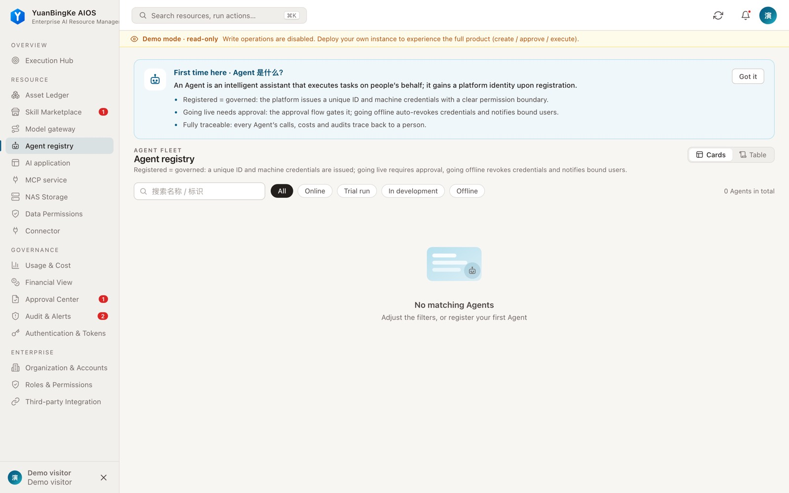
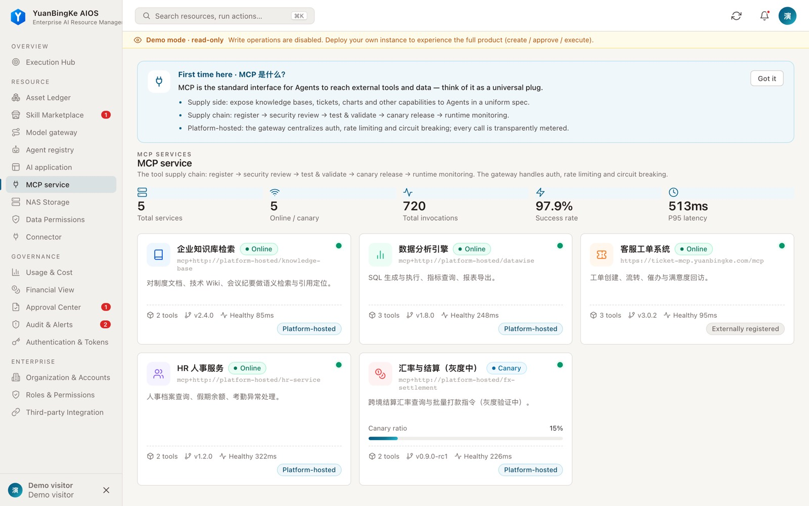
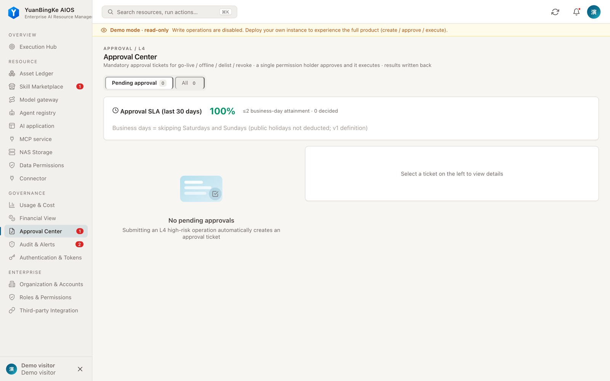

<p align="center">
  
</p>

<h1 align="center">YuanBingKe AIOS</h1>

<p align="center"><strong>Digital employees and enterprise AI capabilities, working together under one governance plane.</strong></p>
<p align="center">An enterprise AI runtime and governance platform · Self-hosted · Built on the dsh / cordis plugin system</p>

<p align="center">
  <a href="https://github.com/01men/ybkkasi/actions/workflows/quality-gate.yml"></a>
  <a href="../../../LICENSE"></a>
  <a href="https://nodejs.org/"></a>
</p>

<p align="center">
  <a href="../../../README.md">简体中文</a> · <strong>English</strong> · <a href="README.agent.md">Agent</a> · <a href="../../../README.agent.md">Agent (中文)</a>
</p>

> **English edition** — machine-assisted translation, reviewed by the i18n PM. **The Chinese original governs.**
> Source: [`README.md`](../../../README.md), [`llms.txt`](../../../llms.txt) · Glossary: [GLOSSARY.md](../GLOSSARY.md) · Governance: [README.md](../README.md)

<p align="center">
  <a href="https://demo.ybkkasi.com/"><strong>Live demo</strong></a> ·
  <a href="#quick-start">Quick start</a> ·
  <a href="#mounting-into-dsh">Mount into dsh</a> ·
  <a href="#for-agents-and-developers">Agent access</a> ·
  <a href="deploy-enterprise.md">Deployment guide</a>
</p>

[](https://demo.ybkkasi.com/)

## An AI platform built for collaboration and governance

YuanBingKe connects an enterprise's goals, digital employees, and AI capabilities so that task execution, capability invocation, and delivery acceptance all leave a traceable record. Digital employees are the collaborating subjects; MCP services, skills, model routes, and applications are the capabilities and resources they draw on.

- **Organized collaboration** — work is structured around goals, projects, and tasks, with controlled invocation and delivery acceptance.
- **Capability management** — MCP services, skills, model routes, applications, and connectors are managed in one place, with lifecycle and authorization controls.
- **Enterprise governance** — access is bounded by organization, identity, and permission; approvals, audit, and usage records track what actually happened.
- **Flexible integration** — run the console and API standalone, or reach the platform through the dsh plugin, MCP, and the CLI.

## Interface

The screenshots below come from this repository's demo instance. All data shown is demo data.

| Digital employees | MCP services | Approvals and audit |
| --- | --- | --- |
| [](https://demo.ybkkasi.com/) | [](https://demo.ybkkasi.com/) | [](https://demo.ybkkasi.com/) |

## Quick start

Try it online with no install: [demo.ybkkasi.com](https://demo.ybkkasi.com/).

To run a read-only demo instance locally with Docker Compose:

```bash
git clone https://github.com/01men/ybkkasi.git
cd ybkkasi
docker compose up -d
```

Open [http://localhost:7300](http://localhost:7300). Demo mode exposes the instance's read-only data to visitors, so use it only in an isolated demo environment and never connect it to real business data.

To start a standalone instance from source, you need Node.js ≥ 22.6:

```bash
npm ci
npm start
```

A standalone instance seeds no demo data. First-boot credentials, persistence, backup, and enterprise deployment settings are covered in the [deployment guide](deploy-enterprise.md).

## How it is put together

A running instance is a cordis plugin tree, the same plugin framework dsh uses. Each business domain is an independent plugin package that declares its own dependencies, permission points, and events, and can be started and stopped on its own. Cross-plugin collaboration goes only through the event bus and extension points; plugins never read or write each other's data directly. The repository ships 25 plugin manifests and 9 domain operations skills.

This is why governance is not a layer bolted onto the platform: organization, identity, permissions, metering, and audit each belong to their own domain plugin and each answers to the caller on its own terms.

## Mounting into dsh

The project ships a plugin bundle for the dsh `web` profile; the declared compatibility range is `>=0.1.0-rc.7 <0.2.0`. Mounting into dsh is still experimental — verify the version you use in an isolated environment first.

```bash
dsh plugin --profile web add github:01men/ybkkasi
```

The mount places the console and API under the `/rq` prefix of the dsh web service. A remote dsh can also join an existing platform with a one-time enrollment code, with credentials and authorization scope managed by an administrator. Details are in the [deployment guide](deploy-enterprise.md).

## For agents and developers

| Entry point | Purpose |
| --- | --- |
| [Agent view (EN)](README.agent.md) | Integration facts and security boundaries for automated callers |
| [Agent view (中文)](../../../README.agent.md) | Same, in Chinese |
| [llms.txt](../../../llms.txt) | Project summary, agent operating boundaries, and document index |
| [Operations skill index](../../../skills/dsh-ops-admin/SKILL.md) | Find the operations manual for a domain; read directly or install into dsh's skill directory |
| `POST /mcp` | MCP interface for platform operations tools; the tool list is filtered by caller permissions |
| `GET /api/openapi.json` | REST description of the current instance; requires authorization |
| [CLI](../../../cli/dshctl.mjs) | Platform operations CLI, supports `--output json` |

Paths above assume a standalone instance; the dsh mount form uses the `/rq` prefix. Use authorized credentials for protected endpoints. The CLI's `--dry-run` applies only to operations that explicitly support preview; other writes are refused.

Endpoint and tool counts change with version and caller permissions, so they are not pinned in this document. Treat the target instance's `/api/openapi.json` and `/mcp` responses as authoritative.

## Operating boundaries

- **Data and availability** — the current storage model is built for single-process operation; do not point multiple processes at the same data directory. Plan backup and recovery before deploying.
- **Permissions and credentials** — grant the minimum required permissions and treat tokens, enrollment codes, and secrets as sensitive. Audit and approval coverage follows the configuration and permissions actually in force.
- **Models and tools** — real invocations require configured services and credentials; demo data and demo execution results do not represent production calls.

## Documentation and community

[Architecture](../../ARCHITECTURE.md) · [Enterprise deployment](deploy-enterprise.md) · [Changelog](../../../CHANGELOG.md) · [Contributing](../../../CONTRIBUTING.md) · [i18n governance](../README.md) · [日本語](../ja/README.md) · [中文](../../../README.md)

This project is released under the [MIT License](../../../LICENSE).