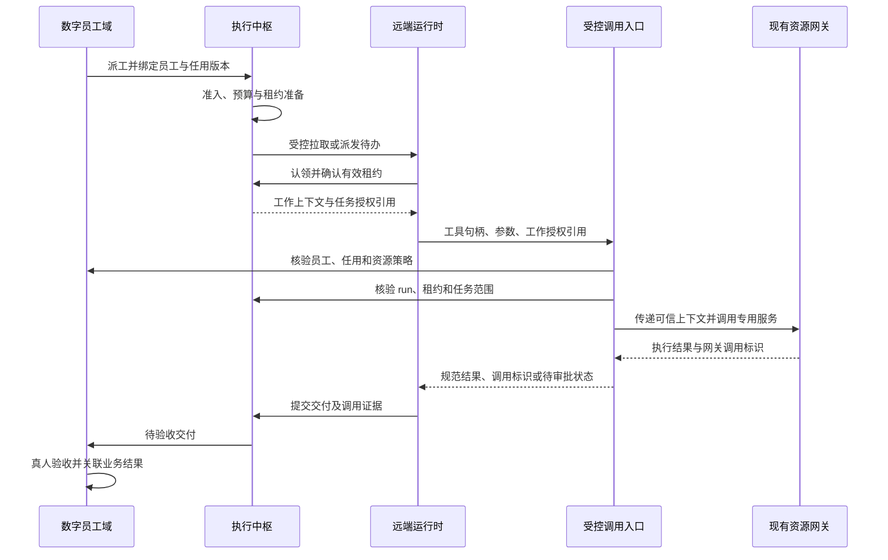

# 数字员工与平台资源调用：技术关联与施工实施路径

> 平台：`01men/ybkkasi`  
> 文档版本：V1.0 · 2026-10-15  
> 适用对象：架构负责人、研发 Agent、业务接入负责人、测试与运维人员  
> 施工前置文档：《数字员工板块建设策略—Agent 管理定位与落地方案》  
> 核对基线：`main@815c14517645f18767cf3b55159309d76474a0c2`，北京时间 2026-10-15 09:34:55 提交；本次重新查询时仍为最新主分支提交。  
> 核对方式：通过 GitHub 读取固定提交的 44 个相关 TypeScript 文件，约 2.0 万行，重点追踪身份、执行、资源调用、授权、计量和审计。  
> 范围：设计与静态源码核对；不修改仓库、HTML 或部署，不代表已运行全链路测试。本文所有“建议新增”接口、字段、目录与状态均是施工目标，不是当前已有能力。

---

## 阅读导航

- 决策与架构：第 1—3 节。
- 现有代码到底怎样调用资源：第 4—7 节。
- 需要新增的数据、服务与协议：第 8—11 节。
- 逐文件施工、顺序与验收：第 12—15 节。
- 真实制造场景和源码定位：第 16 节与附录。

## 1. 先把核心技术关系讲清楚

### 1.1 一句话结论

**数字员工是受委任的工作执行者，平台资源是它履行工作所使用的能力；二者通过“岗位任用、任务授权、运行绑定、资源调用和交付证据”建立关系。**

不能仅在资源台账中把 Agent 改名为数字员工，也不能认为给 Agent 配上模型、Skill 和 MCP 权限组，就已经完成数字员工建设。

### 1.2 施工中必须区分的六种关系

| 关系 | 回答的问题 | 建议事实源 | 是否直接授予执行权限 |
|---|---|---|---|
| 组织任用 | 这个数字员工替哪个岗位、哪个部门工作 | 新数字员工域 | 作为授权依据，不单独放行 |
| 技术身份 | 这个请求真正来自哪个 Agent／机器主体 | 现有 Authn 与 Agent 注册表 | 证明身份，不等于拥有业务权限 |
| 静态依赖 | 员工或模板会使用哪些模型、工具、技能 | 资源依赖图、能力绑定 | 否 |
| 使用授权 | 可以对什么资源执行什么动作 | 岗位／任务策略与既有权限组 | 多层共同满足才允许 |
| 实际调用 | 本次任务实际调用了什么、参数和版本是什么 | 调用记录、网关记录、usage | 已发生行为的证据，不是后续通行证 |
| 交付归因 | 调用结果用于哪项工作、谁验收 | 任务、交付物与验收记录 | 不替代资源授权 |

例如，把“MES 工单连接”添加到排程专员依赖图，只能证明设计上的关联；必须再有主体权限组、任务范围、工厂与单据限制，才可以读取；写入还需要具体业务动作审批。现有 `resourceCore.addDependency()`、`topology()`、`impact()` 分别提供依赖登记、拓扑和反向影响查询，并不代替各资源的授权检查。[C24]

### 1.3 三条绝不能画等号的关系

- `Agent attrs.skills` 中有某技能 **不等于** 运行时已经加载并执行了该技能。
- 机器令牌具有 `mcp.invoke` **不等于** 可以调用所有 MCP 服务和工具。
- 执行中枢登记 `run.status=running` **不等于** 远端运行时已收到、认领并执行任务。

本次施工的核心是把这些“配置关系”补成“可验证的执行关系”。

---

## 2. 当前仓库的实际调用架构

### 2.1 已有架构分为四层

| 层次 | 当前主要代码 | 已承担职责 |
|---|---|---|
| 身份与入口 | Console 鉴权中间件、`rest-gate`、`bridge.ts`、Authn | Bearer 验证、调用主体、路由／工具权限、REST／平台 MCP 入口 |
| 工具与执行 | `ctx.tools`、`plugin-exec-hub`、Panel | 工具注册与执行、目标任务、唤醒、run 登记、面板对话 |
| 专用资源网关 | MCP、Connector、ModelGateway、NAS、SkillHub | 各类资源的实际传输、授权、版本、风险与运行记录 |
| 共用治理 | ResourceCore、IAM、Usage、Audit、SQLite | 依赖关系、组织、权限、计量、审批、审计与持久化 |

**现有资源服务不需要推倒重建；缺少的是将其收敛到数字员工任务上下文的业务执行层。**

### 2.2 必须区分两个方向的 MCP

**方向 A：平台向 Agent 提供工具。**

外部运行时连接平台 `POST /mcp`，调用平台注册工具，例如 `mcp_invoke`、`connector_execute`、`nas_fs_search`、`exec_claim`。

**方向 B：平台调用外部 MCP 资源。**

平台的 `McpRegistryService.invoke()` 经过权限组和运行检查，再向登记的外部 MCP 服务发送 JSON-RPC `tools/call`。

两者不是同一层网关：前者是平台的调用入口，后者是某一类资源的实际执行出口。外部 Agent 接入平台 MCP 后，仍需通过 `mcp_invoke` 指定已授权资源，不能因此获得外部服务凭证。[C02][C07]

### 2.3 现有四种入口并非完全等价

| 入口 | 现状 | 施工约束 |
|---|---|---|
| REST 领域接口 | `/api/mcp/invoke`、`/api/connector/execute` 等 | 同样必须承载任务／任用约束，不能绕过新业务入口 |
| REST 工具桥 | `POST /api/tools/execute`，请求体使用 `name` 与 `args` | 当前路由先要求 `console.login`，再检查工具声明权限 |
| 平台 MCP | `POST /mcp`，`tools/call` 使用 `name` 与 `arguments` | 声明权限的工具检查该权限；未声明者回退 `console.login` |
| dsh 原生工具 | 同批插件直接注册到宿主 `ctx.tools` | 独立宿主与 dsh 的运行时能力不同，必须分别验收 |

现有默认 Agent 机器凭证包含 `exec.read/write`、`mcp.invoke`、`connector.invoke` 等，但未默认包含 `console.login`。因此同一机器凭证可能能调有明确权限声明的 MCP 工具，却不能直接使用要求 `console.login` 的 REST 工具桥。不能用“都是工具桥”概括为已经全通，也不应为图省事给所有数字员工补管理员或控制台权限。[C02][C03][C05]

---

## 3. 建议的目标架构与调用闭环

### 3.1 保留三套各司其职的事实源

1. **数字员工域**负责员工、任用、岗位、真人主管、资源使用策略和交付验收。
2. **执行中枢**负责目标、项目、任务、唤醒、执行租约和 run。
3. **专用资源域**继续负责实际资源调用、原有权限检查和用量事实。

新增一个受控资源调用入口，将三者关联起来；不复制三套身份系统，也不把所有现有资源服务重写成统一的万能执行器。

### 3.2 目标时序

下图为建议实现，不表示当前链路已经完整存在：



审批拒绝、预算超限、依赖不可用、运行时取消、回执乱序等失败路径，必须与成功链路一同实现。

### 3.3 一期选择

建议以**现有外部／dsh 运行时执行工作，平台提供派工、租约与受控资源调用**作为一期主路径。平台内自建完整 Agent 推理执行循环作为可选后续能力，不作为数字员工上线的必要前提。

这样能保留当前底座和已接入运行时，把施工精力用于身份、任务、权限、调用、证据和验收的闭环。

---

## 4. 按资源类型拆解：现状、技术关联与改造点

### 4.1 模型：提供推理能力，不承担岗位身份

**当前路径：**Panel 或 A2A 路由 → `ctx.modelGateway.invoke()`；渠道组可经 `invokeWithFallback()` 执行。网关核验模型状态、数据分级和预算，调用兼容 `/chat/completions` 的上游，再按实际 input／output tokens 登记 usage。[C09][C13][C14]

**当前边界：**已核对的 `ModelInvokeInput` 只有消息、模型、组织、subject、密级、Token 等字段；`invokeOnce()` 未传递工具 schema，也未处理 `tool_calls`。当前单轮问答不能作为自动选择并反复调用企业工具的完整执行引擎。

`modelgw-tools` 当前只注册 `model_list`。本次核对到的可调用 REST 路径包括 `/api/modelgw/channel-groups/:slug/invoke`，未在已核对的相关实现中发现旧接入文案提到的同名通用 `/api/modelgw/invoke` 实现，施工不能直接假定该入口存在。[C09][C10]

**建议关联：**每次模型调用绑定员工、run、任务、任用版本和步骤；`subject` 使用服务端确认的技术 Agent 归因，保留原始发起人作为独立字段。

**改造点：**

- 将密级从可信任务／数据策略推导，不信任运行时自行降低 `dataClass`。
- 保持现有模型网关为受控出口；对外运行时如使用自带模型，须明确其独立计量与数据出域边界。
- 扩展调用上下文及关联记录，让预算能按同一员工归因，而不是在用户、机器、Agent 三种 subject 之间漂移。
- 如果后续建设平台内推理循环，再增量设计工具 schema、工具调用结果、步数／费用上限和循环终止；不混入一期必需功能。

**密级映射还需专项处理：**Agent schema 的 `confidential`／`secret` 分别带“机密需审批”“绝密禁止 Agent 直接处理”的业务语义，而 ModelGateway 的 `secret` 标签是“秘密”且可被相应渠道处理。不能把二者同名枚举直接等同，也不能简单把缺失枚举回落到 `internal`。先冻结统一业务密级，再由适配器显式映射旧协议；禁止 Agent 处理的密级必须在模型调用前拒绝，而不是映射为可用高等级渠道。[C09][C27]

### 4.2 MCP：数字员工访问业务系统的受控工具出口

**当前路径：**`mcp_invoke` 工具或 `/api/mcp/invoke` → 解析机器主体对应的 Agent → `mcpRegistry.invoke()` → `authorize()` → 真实 MCP 传输 → `recordCall()`。[C06][C07][C08]

**已有约束：**权限组主体匹配、服务／工具白名单、只读约束、服务状态、熔断、限流和调用记录。

**不应误解：**`attrs.mcpPermGroupIds` 是配置字段；实际 `authorize()` 读取权限组的 `subjects` 与服务策略。给 Agent 属性写入一个权限组 ID，不等于已经把它加入该组。任用开通必须调用真实授权逻辑并核验结果。

**改造点：**

1. 一期只向员工开放任务需要的服务及工具，不开放资源部署、权限组维护和全平台运维工具。
2. 保留现有主体权限组授权，再叠加岗位／任务的参数和业务对象约束，例如工厂、产线、工单集合。
3. 对未知风险工具，不把远端 `tools/list` 的发现结果直接当作安全分级。当前同步工具存在默认 `read` 映射，写类能力上线前需要可信风险登记。[C07]
4. `denyParams` 虽在策略类型中出现，但当前 `authorize(caller, serviceId, toolName)` 不接收业务参数，不能将该字段视作参数约束已被完整执行的证据；新增参数策略必须落到执行前校验。[C07]
5. 将新工作上下文传入网关调用和记录，而不是只写在外层 UI 日志。

### 4.3 Connector：外部 SaaS／企业连接器的独立出口

**当前路径：**`connector_execute` → `callerFromPrincipal()` → `invokeAction()` → 主体／权限组策略 → ODD → 审批／限流 → 策略镜像与连接检查 → open-connector 数据面 → usage 与事件。[C11][C12]

**已有较强能力：**`riskCap`、只读／参数限制、连接别名隔离、ODD、策略快照漂移拒绝、admin 动作审批、内部一次性审批能力，以及调用／计量对账。

**改造点：**

- 在现有控制链之前追加员工与任务准入，不替代或删除原有链路。
- 新工作授权与现有 `approvalCapability` 分开：前者是任务使用范围，后者是网关内部的单次审批执行能力，禁止向客户端暴露后者。
- 当前写动作每次 `invokeAction()` 生成新的随机幂等键，单次调用内的恢复重试可以复用，但整个业务步骤重投时仍可能变成新写入。应由服务端步骤账本建立稳定业务幂等键，跨请求复用。
- 记录部门任用组织、资源所属组织、连接所属组织，分别做归属判断；不能因为命中某个权限组就丢失原始工作组织。

### 4.4 Skill：能力说明、技能包与可执行程序要分型

**当前安装语义：**`skillHub.install(skillId, version, agentId, actor)` 校验上架版本、登记 `agent → skill` 依赖、回填 `attrs.skills`、记录安装观测。[C15]

**当前面板直调语义：**`PanelService.invokeSkill()` 读取已发布版本的文本内容，作为系统指令发给模型，获得单轮应答。它不是通用代码沙箱，也不等于执行技能包中的任意程序。[C13]

**现有缺口：**安装入口虽然接收 version，但依赖边及 `attrs.skills` 没有形成一份可供每次运行核验的完整版本锁定清单。运行时是否实际加载、加载的是哪个包、版本是否一致，需要新增证据。

**建议分型：**

| 技能类型 | 运行方式 | 必需证据 |
|---|---|---|
| 指令／方法技能 | 加载固定版本文本或模板 | 版本、内容摘要、来源与加载记录 |
| 工具组合技能 | 调用明确登记的资源网关步骤 | 版本化编排、每步授权和调用记录 |
| 程序／脚本技能 | 运行时在受控执行环境中运行 | 包摘要、能力清单、执行隔离与输出记录 |

一期优先指令和明确工具组合。不因“静态扫描通过”就把未知代码交给平台主进程执行。运行时加载的指令也不能修改员工权限或成为可信身份来源。

### 4.5 NAS／文件：文件能力不等于知识检索能力

**当前路径：**`nas_fs_*` 工具或文件 REST → `NasRegistryService` → MCP 文件网关。平台保管网关访问凭证；真实用户可通过受控 `X-On-Behalf-User` 传递，网关结合文件权限规则执行。[C16][C17][C18]

**两个必须补齐的边界：**

1. 当前文件工具的 `actorOf()` 在机器调用时可能得到机器 principal ID；它不是一个天然存在的真人用户。不能把 employee ID／principal ID 随意放进 `X-On-Behalf-User` 冒充真人权限。dsh 形态还存在会话身份绑定优先路径；多员工并发时必须核验精确会话绑定，不能沿用单操作者“最近一次绑定”的便利假设。
2. `nas_fs_upload` 的 `localFile` 当前指向平台侧可访问的绝对路径。远端 Agent 的本机路径既不等于平台路径，也不能因此获得读取平台任意文件的能力。

**建议实现：**

- 人代办：保留经过验证的真人链与员工身份，文件范围取二者与任务授权的交集。
- 无人值守岗位：建立明确的文件服务主体映射与目录授权，不能默认借用业务主管的全部文件权限。
- 平台内部技能发布使用服务身份上传，继续走已有明确内部路径；不把 `onBehalf=false` 开关开放给普通员工绕过文件授权。
- 员工交付上传改用“受控上传 → artifact ID → 服务器 staging → 网关写入”，不向员工开放任意 `localFile`。
- `read/search/list/write/share` 逐动作授权；知识读取和向外分享必须是不同权限。

NAS 文件搜索、下载和数据集登记不自动组成 RAG。若岗位需要文档解析、向量索引、检索和引用，应登记明确的知识检索服务／适配器，保留索引版本和文档来源；不得仅增加“知识库”名称就宣称已具有检索增强能力。

### 4.6 AI 应用：有统一登录，不代表有机器可调用 API

**当前能力：**应用登记、身份纳管、入口、运营指标、关联依赖和 SSO 等。[C23]

数字员工可以被应用调用，也可以使用应用提供的业务能力。但仅登记 `entryUrl` 不代表平台可以把该 URL 当作函数调用。

**建议：**具备机器 API 的应用，通过明确登记的 MCP／Connector／专用适配器接入；只有页面的应用，如需浏览器操作，作为独立且受限的执行适配器建设。不能让运行时提交任意 URL，由平台携带内部凭证代为请求。

### 4.7 平台运维工具：与员工业务工具隔离

现有 `ctx.tools` 同时包含平台运维与资源调用工具。数字员工执行质检或排程任务，不应获得 `mcp_deploy`、审批决定、权限维护、Token 管理、平台升级等管理能力。

建议生成“岗位能力清单”，只下发本任务允许的工具句柄与参数 schema；工具目录过滤用于减少误用，真正的强制控制仍在执行服务端。即使运行时猜到未下发的工具名，也不能执行。

---

## 5. 身份链路：谁在调用、替谁工作、谁承担成本

### 5.1 保留现有身份，不批量改协议

| 标识 | 用途 | 施工规则 |
|---|---|---|
| `employeeId`（建议新增） | 岗位员工的稳定业务身份 | 由数字员工域签发，改名／重启不变 |
| `appointmentId/version`（建议新增） | 此次工作依据的任用与边界 | 服务端核验有效期、组织与版本 |
| `agentId`（已有） | 现有技术 Agent 实体 | 保留原 ID、API 与历史记录 |
| `principalId`（已有） | 机器认证与令牌 | 从 Authn 验证结果反查，不信任参数 |
| `userId`／`actChain`（已有） | 原始业务发起人与代理链 | 与员工身份同时保留，不能互相覆盖 |
| `issueId/runId/leaseVersion` | 工作与执行所有权 | 与认证主体及任用绑定 |
| `resourceRef` | 具体被调用资源 | 解析为现有模型、MCP、技能、NAS 等规范键 |

### 5.2 统一身份解析器是第一项施工任务

当前 REST 中间件会传递机器 `refType/refId`，平台 MCP 的 `mcpCallerFromToken()` 未显式透传这两个字段；`exec_claim` 却按 `exec.principal.refType === 'agent'` 进入任务归属检查。`ToolPrincipal` 公共类型本身也没有完整表达这两个字段。[C01][C02][C03][C04]

这说明不能依赖“某入口刚好塞了字段”执行所有权判断。必须建立统一解析器：根据已经验证的 `principalId` 回查真实机器主体，再解析 Agent、数字员工与任用，身份字段缺失或不匹配时拒绝。

该差异是源码事实；是否可形成端到端越权还需要真实入口验证，本文不把静态差异等同于已完成漏洞复现。

### 5.3 OBO 有用，但不能替代岗位／任务授权

现有 `issueOnBehalfOf()` 采用父主体 scopes 与目标主体 scopes 的交集，验签时进一步收紧。[C03]

可以复用其代理链能力，但 OBO 不包含岗位、工厂、任务参数、审批内容或租约，仍需新增工作授权。人代办和无人值守两种模式必须区分：

- 人代办：真实发起人、员工、任务与资源权限同时满足，保留代理链。
- 无人值守：按经过任用的岗位服务权限执行，不伪造人类发起人；真人主管只是责任人，不自动成为每次请求的代理用户。

### 5.4 明确四种组织维度

员工所属组织、任务归属组织、资源所属组织、内部成本归口组织可能不同。每次调用分别记录，跨组织访问必须显式获准。

当前 MCP 用量常按资源服务组织归口，Connector 按命中权限组组织归口，Panel 模型调用可能按用户组织归口。新增员工成本看板之前，要明确这些口径，不能仅替换一个 `org` 字段使历史统计失真。[C07][C11][C13]

---

## 6. 执行中枢与真实运行时怎样衔接

### 6.1 已有能力应直接复用

`plugin-exec-hub` 已有目标／项目／任务、血缘、依赖、唤醒队列、run、例行规则、预算前置、P0 审批、执行锁、超时回收以及 `exec_claim/exec_complete`。[C04]

一期不新建第二套任务引擎，只增加员工引用、真实执行握手、可靠租约和交付验收。

### 6.2 当前“派发”和“认领”需要统一语义

当前 `processWake()` 可能先创建 run、获取任务锁并把任务置为进行中；`exec_claim` 遇到已有 `executionRunId` 又直接返回锁已被持有。与此同时上下文提示运行时应先 `exec_claim`。[C04]

这会在“调度已预先持锁，运行时再认领”的情况下产生语义冲突。施工前必须确定唯一规则：

**建议采用预约与认领分离。**

1. 调度创建持久待办／dispatch，确定目标员工，但不把未接收任务宣称为业务执行中。
2. 运行时拉取并确认接收，通过统一准入服务认领，原子获得执行租约。
3. 若已有同一员工、同一 dispatch 的有效租约，幂等返回已有 run，不再报“他人持有”。
4. 其他员工、其他任用、旧租约或已关闭工作不得认领。

若选择保留调度预取锁，则认领必须成为“认领已分配租约”的幂等确认，不再另造 run。两种方案只能选择一种权威语义，不能混用。

### 6.3 别把平台接入客户端当作员工运行时

`plugin-connect` 主要提供客户端接入、机器凭证与平台工具远程代理，`client.forward()` 使用接入客户端凭证调用宿主工具桥。它不天然代表某名数字员工，也不等于“平台把工作推送到远端并得到执行回执”。[C20]

建议：接入客户端作为连接／工作节点身份；每次执行另绑定员工机器主体、任用与 run。共享节点同时承载多个员工时，不能把所有调用记到同一客户端身份下。

### 6.4 采用可靠拉取优先，推送作为提示

一期建议持久待办＋运行时带身份拉取／认领。推送、webhook 或会话通知可以提示有新工作，但不能是唯一持久记录。

运行时契约至少覆盖：能力声明、领取、租约续期、进度、资源调用、交付、失败、取消与恢复。其证据分别标识：已派发、已收到、已认领、正在执行、待验收，而不是都映射为 `running`。

### 6.5 完成与验收分开

当前 `completeRun()` 会将相关进行中任务移到 `review`，这是可复用的方向；但 `exec_complete` 入口还需补显式主体／run 所有权校验、证据引用、失败状态处理和旧租约拒绝。[C04]

新增交付物记录后：技术执行完成只形成“交付已提交”，由具备权限的真人验收人决定通过或退回。模型输出“成功”和 HTTP 200 都不能直接关闭业务任务。

---

## 7. 当前最需要补齐的跨层断点

| 编号 | 源码观察 | 施工处理 | 验证重点 |
|---|---|---|---|
| D01 | 工具主体结构在 REST／MCP／宿主间不完全一致 | 统一可信身份解析与 Agent 反查 | 同凭证、同任务在多入口得到相同主体 |
| D02 | Lite `guard()` 只接收工具名与参数，不能直接读取 principal | 增加上下文型 guard／调用策略接口，保留旧 guard 兼容 | 缺身份与缺工作授权均拒绝 |
| D03 | Lite 执行体不自行强制检查工具声明的 permission，入口承担部分检查 | 服务端通用准入与资源服务约束共同生效 | 原生调用／内部调用不能绕过 |
| D04 | 默认机器 scopes 与 REST 工具桥的登录基线不同 | 建新工作调用权限入口，旧桥逐步适配 | 不通过新增 `*` 或全量控制台权限解决 |
| D05 | 派发预取锁与认领遇锁拒绝语义冲突 | 预约／认领分离或幂等确认已分配租约 | 任务可被实际目标运行时认领 |
| D06 | 工具认领与调度准入流程不一致 | 抽出统一 admit／claim 服务 | 冻结、预算、P0／动作审批无法绕行 |
| D07 | 完成工具未显式读取调用主体校验归属 | 服务层校验 run、员工、租约、任用 | 跨员工及旧运行时回执被拒绝 |
| D08 | Panel／A2A 为单轮模型调用，未构成工具执行循环 | 一期对接外部运行时；内建循环后置 | 有真实工具与交付证据才算任务执行 |
| D09 | Skill 安装只登记依赖与属性，未证明加载与版本锁定 | 版本化能力清单及运行时加载确认 | 安装版本、加载摘要和实际使用一致 |
| D10 | 底层授权缺岗位／任务和稳定业务步骤信息 | 追加任务级策略与调用上下文 | 工厂／工单／目录／参数约束执行到出口 |
| D11 | usage／审计缺统一工作关联，不同入口 subject 不同 | 调用关联账本与规范归因 | 员工、任务和资源可穿透，对账不双计 |
| D12 | 运行时上传路径与平台路径不同 | artifact 上传服务与受控 staging | 不能读取平台任意本地路径 |
| D13 | 上线默认健康、接入心跳和工作进展容易混淆 | 技术健康与业务进展分维度 | 无观测为未知，不伪造执行 |
| D14 | Agent 与模型同名密级键的业务语义不同 | 统一业务密级并显式映射，禁止处理先拒绝 | 绝密不会因映射变成可调用模型 |
| D15 | NAS 存在宿主会话身份优先路径 | 精确绑定当前员工会话和授权，不回落最近操作者 | 并发会话文件归属不会串用 |

这些断点是实施清单，不要求通过重写技术栈解决。

---

## 8. 新增最小技术模型

### 8.1 员工与资源的版本化绑定

建议新增下列对象，原有 Agent、目标和任务继续复用：

| 对象 | 关键字段 | 事实归属 |
|---|---|---|
| 员工档案 | employeeId、主组织、真人主管、任用状态 | Workforce |
| 任用版本 | appointmentId、employeeId、岗位、组织／工厂、策略、有效期 | Workforce |
| 运行绑定 | bindingId、employeeId、agentId、runtime、principalId、能力版本 | Workforce／运行适配层 |
| 能力清单 | manifestVersion、Skill 版本、资源引用、工具句柄、参数 schema | Workforce 能力装配 |
| 资源授权 | grantId、任用版本、资源、动作、条件、审批依据、授权版本 | Workforce 策略 |
| 工作授权 | permitId、主体、issue、run、租约版本、清单、到期时间 | 执行准入／调用层 |
| 调用与步骤 | invocationId、stepKey、参数摘要、状态、资源调用 ID | 受控调用账本 |
| 交付物与验收 | artifactId、交付版本、证据列表、验收决定 | Workforce 与现有任务关联 |

### 8.2 不同“版本”不能合并

- 任用版本：工作组织与权限边界。
- 能力版本：提示词、代码和技能组合。
- 资源版本：实际 MCP、Skill、模型路由等配置版本。
- 租约版本：当前谁有权代表此次 run 执行，旧版本必须失效。
- 策略版本：授权变更后旧工作许可不能继续扩大使用。

每次业务动作记录这些关键引用，员工调岗或资源升级不改写历史事实。

### 8.3 建议的可信执行上下文

以下为建议类型示意，不是当前已经存在的类型：

```ts
interface WorkforceExecutionContext {
  employeeId: string;
  agentId: string;
  principalId: string;
  appointmentId: string;
  appointmentVersion: number;
  deploymentBindingId: string;
  tenantId: string;
  workOrgId: string;
  requesterUserId?: string;
  actChain: VerifiedActor[];
  issueId: string;
  runId: string;
  leaseVersion: number;
  capabilityManifestId: string;
  policyVersion: number;
  traceId: string;
}
```

运行时可提交任务和授权引用，但上面身份、组织、版本和代理链必须由服务端解析／核验。不能把客户端传入的一份同形 JSON 当作可信上下文。

建议采用短期、不透明工作授权引用，服务端保存绑定记录；调用者仍须携带真实机器令牌。获得 permit 字符串但没有匹配机器主体，不能调用。自签 JWT、仅在 URL 中放员工 ID、把 `agentId` 作为普通工具参数都不是等效方案。

---

## 9. 新受控资源调用入口：复用网关，不代替网关

### 9.1 建议新增服务

建议建立 `ResourceInvocationService`，放在新 `plugin-workforce` 的独立子模块内。一期不必额外拆成另一套平台或微服务。

它负责：验证工作授权、解析工具句柄、校验输入、检查岗位／任务／预算／审批、登记步骤、调用既有资源服务、整理结果和建立证据关联。

**它不负责：**重新实现 MCP 传输、替换 Connector 数据面、重复维护模型渠道、另建 NAS 文件网关或直接保管所有供应商密钥。

### 9.2 工具句柄与能力清单

给运行时下发的不是“平台全部工具”，而是任务允许的能力：

```json
{
  "manifestId": "manifest-example-1",
  "version": 1,
  "tools": [
    {
      "handle": "quality.read_inspections",
      "kind": "mcp",
      "resourceRef": "mcp:quality-gateway",
      "action": "inspection_query",
      "risk": "read",
      "constraints": {
        "factoryIds": ["factory-jinhua"],
        "maxRows": 200
      }
    },
    {
      "handle": "quality.read_sop",
      "kind": "nas",
      "resourceRef": "nas:example-quality-docs",
      "action": "read",
      "constraints": {
        "pathPrefixes": ["/quality/sop/"]
      }
    }
  ]
}
```

示例资源须经真实注册表解析，不直接拿示例字符串调用。工具句柄由服务器映射到 serviceId、tool、连接别名或目录；运行时不能在请求中替换为另一个未授权服务。资源的计量键、注册表 ID 和依赖图类型不一定同名，必须按附录 D 的映射解析，不能直接切分字符串后通用调用。

### 9.3 建议新增调用端点

建议端点：`POST /api/workforce/invocations`，权限点建议为 `workforce.invoke`。

```http
POST /api/workforce/invocations
Authorization: Bearer <员工机器令牌>
Content-Type: application/json

{
  "permitId": "permit-example",
  "toolHandle": "quality.read_inspections",
  "stepKey": "inspect-batch-q1024",
  "arguments": {
    "batchId": "Q-1024",
    "factoryId": "factory-jinhua"
  }
}
```

`stepKey` 是调用方提出的业务步骤引用，不是可信身份。服务端对其长度、字符、run 范围及参数摘要进行校验，并生成全局 invocation ID。相同步骤键配不同参数不能静默复用原结果。

建议响应规范：

| 状态 | 含义 | 运行时应做什么 |
|---|---|---|
| completed | 已有确定结果及证据引用 | 继续工作或提交交付 |
| denied | 权限／任用／数据边界不满足 | 停止该动作，不换入口重试 |
| approval_required | 需要具体业务动作审批 | 暂停并展示审批单，不能当成工具失败循环调用 |
| rate_limited | 命中可重试流控 | 遵守服务端重试策略 |
| failed | 确认未成功或执行失败 | 按动作可重试性处理 |
| outcome_unknown | 外部请求结果不确定 | 先查证／人工核验，禁止自动重新写入 |
| cancelled | 任务或任用已撤销 | 停止后续调用 |

应分别保留 HTTP 状态和领域状态；不能仅用 HTTP 200 作为业务成功判断。

### 9.4 准入与执行伪代码

```ts
// 施工示意：函数与仓储接口均为建议新增。
async function invoke(request, verifiedIdentity) {
  const ctx = await resolveWorkPermit(request.permitId, verifiedIdentity);
  const tool = await resolveManifestTool(ctx, request.toolHandle);
  const args = validateSchemaAndBusinessScope(tool, request.arguments, ctx);
  const inputHash = hashCanonicalArguments(args);

  const step = reserveStepAndBudgetAtomically(ctx, request.stepKey, inputHash);
  if (step.hasSettledResult) return step.result;
  if (step.outcomeUnknown) return requireReconciliation(step);

  // 事务外执行网络请求，避免持有 SQLite 写锁等待远端。
  await revalidateAppointmentLeaseAndApproval(ctx, tool, inputHash);
  const outcome = await invokeExistingGateway(tool, args, ctx, step);
  return persistResultEvidenceAndOutbox(ctx, step, outcome);
}
```

预算预留、步骤登记、授权复核和结果持久化需要明确失败语义，不能把以上伪代码直接等同于现成可部署实现。

### 9.5 两层授权必须同时成立

**工作级授权**：员工在岗、任用有效、任务和租约有效、当前操作属于工作目的。

**资源级授权**：MCP 权限组、Connector 策略、NAS 目录和身份、模型密级与预算、技能可见性及版本等。

两层取交集。新入口批准不应跳过现有资源网关规则；资源网关放行也不能代替工作级授权。

---

## 10. 防绕行与装配：不能只在新页面前加一道门

### 10.1 需要保护的真实入口

至少覆盖：新工作调用 API、REST 工具桥、平台 MCP、领域 REST、dsh 原生工具、内部服务调用、A2A、Panel、运行时直接连接业务资源和计量自推。

工具清单过滤不是安全边界；前端隐藏按钮也不是。数字员工仍可知道旧地址或工具名，必须由后端拒绝不带有效工作授权的业务动作。

### 10.2 推荐的无循环依赖实现

当前装配顺序为资源服务、Agent／App、模型、Console、Panel、Flow、ExecHub 等。[C25]

若新 Workforce 依赖 ExecHub，而 ExecHub 又强依赖 Workforce，Cordis 注入会形成装配问题。建议采用以下结构：

1. `platform-core` 新增窄接口：可信调用上下文、准入策略提供者、执行作用域；不反向 import 业务插件。
2. 各资源服务提供执行前策略扩展点，或在其真实调用路径消费已登记的窄策略服务。
3. 新 Workforce 在现有基础服务之后装配，登记策略提供者及资源适配器。
4. ExecHub 的员工工作路径通过登记的策略端口执行准入；新工作模式开启但提供者未就绪时拒绝，不降级为无策略执行。
5. 启动阶段完成注册后才开放员工工作接收；ready 状态与缺失能力可观测。

这套机制是建议新增扩展点，不是仓库现有 `plugin-ctx` 已提供的完整安全沙箱。[C26]

### 10.3 不要仅依赖现有 Lite guard

当前 Lite `guard` 输入仅有 name 与 arguments，`execute()` 接收 principal 但并未把它传给 guard；实际也不能假定宿主 dsh 支持所有 Lite 扩展。[C01]

建议补上下文型 guard／公共准入调用，保留旧 guard 的兼容包装；同时在真实资源网关上执行员工调用策略。REST、MCP、原生工具只适配上下文，不各自复制一套政策。

所有状态变更型工具必须有明确 permission；员工可用工具禁止依靠“未声明权限即登录可用”的默认行为。

### 10.4 技术参数透传与可信作用域

进程内调用可采用显式、只读的可信上下文对象；必要时用执行作用域辅助传递。但仅凭结构相同的参数不能证明可信，授权仍要回查有效记录。

HTTP 头中的 employee／run／trace 引用只作为索引，不能直接成为授权事实。代理后的请求必须保留主体绑定；不能用 `X-Employee-Id`、`actorId` 或“平台内部请求”标记绕过验证。

### 10.5 平台内部动作单独分类

现有技能发布等内部服务上传可以继续使用服务身份；但必须由受信任内部路径发起，有明确用途和审计。数字员工不能通过指定“内部模式”把一次文件读取升级为平台服务身份。

管理员手工维护与员工岗位执行是两类调用目的，均保留鉴权。兼容旧管理员接口，不等于允许所有机器主体无任务调用。

---

## 11. 计量、审计、幂等与持久化实现

### 11.1 计量事实仍由现有生产者登记

| 生产者 | 当前主要资源键 | 当前关键特征 | 新增关联位置 |
|---|---|---|---|
| ModelGateway | `model:<slug>` | 实际 input／output tokens、内部成本 | 员工／run／step／trace 关联 |
| MCP | `mcp:<slug>` | 调用记录、real 模式 usage；demo 不进正式用量 | 调用 ID 与 invocation 映射 |
| Connector | `connector:<provider>` | 数据面 executionId、调用计量与对账 | 稳定业务步骤键及调用映射 |
| NAS | `nas:<id>` | 文件 calls／bytes | 员工身份、文件操作、artifact 与 run |
| SkillHub | `skill:<id>` | 安装／下载是观测事件 | 版本加载与使用引用，不重复计模型成本 |
| Panel／A2A | `kb:*`／`agent:*` 等协作记录 | 非计费调用观测，具体取决于入口 | 区分协作次数与实际资源消费 |

新受控调用入口**不能在底层已登记模型／MCP 成本后再登记一次相同消费**。它创建工作调用记录和事实映射，而不是复制消费流水。[C19]

### 11.2 保留现有 Agent 计量防双计机制

现有 AgentRegistry 对 `McpInvoked` 做调用统计；从 usage 回灌时跳过 `mcp:*`，并排除技能安装／下载事件，避免重复统计。[C05]

新增员工视图时沿用同一思路：员工、任务、资源成本是同一事件的不同维度，不能把各层聚合结果再相加。技术调用成功率也不能作为业务任务验收率。

### 11.3 增量关联，避免破坏 schema v1

建议一期保留现有 `subject=agent:<id>` 和所有历史 resource 键，新增关联表记录：

`invocationId → employeeId → appointmentVersion → runId → issueId → gatewayCallId → usageEventId`。

生产者支持时附加统一 `trace_id`；新增可选字段按现有 additive-only 契约实现，并同步数据库持久化、查询、重放、投影与消费方。只扩 TypeScript 接口，不改落库序列化和读取路径，会造成字段“看似传了，实际丢了”。

建议区分完整工作 trace、单次 invocation、子调用 span，不把一个 trace 下的所有动作共用同一个 usage 幂等键。

### 11.4 参数、结果与敏感数据

审计保存规范参数摘要、资源版本、作用对象、调用主体、审批引用、状态、延迟和证据引用。原始敏感内容按最小必要原则保存在受控存储，不复制到 prompt、审批标题和通用日志中。

错误信息需要保留可定位原因，但不能暴露供应商 Key、连接 Token、NAS 凭证或完整敏感响应。岗位上下文加载也不得将密钥发给模型或运行时。

### 11.5 同一业务步骤的幂等规则

1. 使用稳定的 run＋step 标识，并保存规范参数摘要、目标资源与动作。
2. 相同标识与相同参数：已成功则返回原结果；执行中返回已有状态。
3. 相同标识但不同参数／目标：冲突拒绝，不能覆盖原动作。
4. 写入超时且结果未知：先查询业务单据或外部 executionId，无法确认则转人工，不自动生成新写请求。
5. 只读失败可按明确策略重试；写操作是否重试必须由适配器声明并经过业务验证。
6. 外部系统不支持幂等时，平台的步骤唯一约束仍不能证明外部“恰好一次”；高风险动作应限制自动执行。

### 11.6 利用现有 SQLite，但不能假定现有封装已完成迁移

`txnStore` 已提供同步 `BEGIN IMMEDIATE`、唯一索引、原生写入与事务能力，可作为步骤唯一性、租约、调用状态和待发事件的基础。[C21]

建议新增权威表：

| 表（建议名） | 用途 | 关键约束 |
|---|---|---|
| `workforce_employees` | 员工／Agent 映射与状态 | employee 主键；活动技术绑定约束 |
| `workforce_appointments` | 任用与授权版本 | 员工＋任用版本唯一，组织不可空 |
| `workforce_permits` | 短期工作授权 | 绑定主体、run、租约与到期／撤销状态 |
| `exec_run_leases` | 有效执行租约 | 同任务仅一个活动租约；递增版本 |
| `workforce_invocations` | 每次业务调用 | run＋步骤键唯一；参数摘要不可变 |
| `workforce_usage_links` | 工作调用与消费事实关联 | 同 invocation＋usageEvent 不重复 |
| `workforce_artifacts` | 交付／输入文件元信息 | 受控存储引用、组织与版本 |
| `workforce_outbox` | 已提交状态的待发事件 | 事件唯一键、重试与消费水位 |

必须明确每个字段只有一个权威存储。若执行租约或 run 状态从 JSON 迁到 SQLite，就通过 DAO 切换为 SQLite 事实源，JSON 仅作兼容投影；不能把两份可写状态分别当真。

网络调用在 SQLite 事务外执行。事务只处理短时间的检查、预留和状态提交；持久结果与 outbox 同事务提交，事件重投按消费水位幂等。

### 11.7 停职、取消、预算与回执

- 停职／离岗：撤销工作 permit，提高授权或租约版本，拒绝后续受控动作，向运行时发送取消。
- 取消：取消请求已发出不等于远端已停止，区分“取消中、已确认停止、外部结果待核验”。
- 预算：预留与实际消费分开；并发不能都读取相同余额后各自放行。部分失败仍可能产生实际模型成本。
- 回执：校验签名／令牌主体、run、任用和租约，旧版本回执只归档，不覆盖新状态。
- 平台重启：恢复持久步骤和待办；已发送但未确认的写动作进入核验状态，不简单重新执行。

---

## 12. 逐文件施工地图

### 12.1 新增目录建议

以下为目标目录规划，不是现有文件：

```text
packages/plugin-workforce/
  plugin.yaml
  manifest/{api,events,permissions,ui}.yaml
  src/domain.ts
  src/employee-service.ts
  src/appointment-service.ts
  src/identity-resolver.ts
  src/admission-service.ts
  src/capability-manifest.ts
  src/permit-service.ts
  src/invocation-service.ts
  src/adapters/{mcp,connector,model,skill,nas,app}.ts
  src/artifact-service.ts
  src/acceptance-service.ts
  src/repositories.ts
  src/migrations.ts
  src/index.ts
```

不要求第一批将所有适配器做全。先完成明确场景所需类型，缺席能力返回未支持，不以空实现冒充成功。

### 12.2 现有文件修改表

| 现有位置 | 核心修改 | 不应做的事 |
|---|---|---|
| `platform-core/src/tools-lite.ts` | 补完整可信主体类型、上下文型准入扩展与兼容包装 | 只增加一个未被使用的 employee 参数 |
| `platform-core/src/rest-gate.ts` | 共用身份解析／工作上下文入口 | 各路由分别相信请求体身份 |
| `plugin-console/src/index.ts` | REST 验证结果统一结构 | 给机器身份默认管理员权限 |
| `plugin-console/src/routes/bridge.ts` | REST／MCP 同源 principal 解析、工作授权适配、工具目录收敛 | 只改其中一个入口 |
| `plugin-agent/src/index.ts` | 技术主体与员工映射、停职撤权联动、计量兼容 | 删除或重新生成已有 Agent ID |
| `plugin-agent/src/schema.ts` | 保留技术兼容；岗位信息转由员工域关联 | 持续把全部员工业务字段塞进 attrs |
| `plugin-exec-hub/src/index.ts` | 抽统一准入；统一 dispatch／claim；校验 complete；租约与回执 | 继续以员工名称作执行所有权 |
| `plugin-exec-hub/src/domain.ts` | 员工准入、状态转换、恢复等纯策略 | 在纯决策模块中执行 HTTP 或读库 |
| `plugin-mcp/src/index.ts` | 真实调用前消费工作策略；补参数／风险控制、关联 ID | 替换掉现有权限组与熔断 |
| `plugin-mcp/src/tools.ts` | 可信 principal／工作上下文传递 | 从 args 接收 callerId 冒充员工 |
| `plugin-connector/src/index.ts` | 任务策略、稳定步骤幂等、调用关联 | 暴露内部审批执行能力 |
| `plugin-modelgw/src/index.ts` | 员工调用上下文、预算预留接口、trace 与调用 ID | 一期顺手重写为完整 Agent 框架 |
| `plugin-skillhub/src/index.ts` | 固定版本装配、依赖与加载证据 | 安装动作直接执行任意技能程序 |
| `plugin-nas/src/index.ts`、`tools.ts` | 人代办／岗位服务身份适配、受控 artifact 文件操作 | 普通员工任意传服务器本地路径 |
| `plugin-usage/src/index.ts` | 可选关联字段或关联仓储、对账与投影 | 双记同一资源成本或改历史资源键 |
| `plugin-panel-core/src/service.ts` | 把“问答”与“执行任务”分开；后者调用工作服务 | 把聊天成功当作工作已完成 |
| `plugin-console/src/routes/agents.ts` | A2A／旧入口员工策略适配 | A2A 因配置 A3 就跳过审批 |
| `plugin-connect/src/client.ts`、`host.ts` | 节点身份与员工执行身份分离、上下文绑定 | 多员工共用一个外部接入主体归因 |
| `src/boot-all.ts`、宿主配置 | 登记新插件与策略端口就绪检查 | 引入循环注入或破坏挂载前缀 |

现有文件路径是基线事实；具体新增服务名称可以在详细设计时调整，但职责和单一事实源边界不能丢失。

### 12.3 装配与发布纪律

同步检查 `plugin.yaml`、`manifest`、权限目录、事件名、工具声明、装配顺序、包入口及 dsh 预构建闭包；同一功能需要覆盖独立宿主和挂载宿主。

遵守当前技术路线：原生 TypeScript／前端、Cordis、JSON 与 SQLite。跨插件协作采用服务接口、事件和受控扩展点，避免在新模块直接读写其他插件私有集合。

---

## 13. 接口与契约施工清单

### 13.1 建议新增的工作接口

| 接口（建议） | 用途 | 关键校验 |
|---|---|---|
| `GET /api/workforce/employees/:id` | 员工业务档案 | 组织范围与字段最小化 |
| `POST /api/workforce/appointments` | 任用与版本 | 主管、岗位、资源策略及审批依据 |
| `GET /api/workforce/work-items` | 运行时拉取本员工待办 | 由机器主体反查员工，不接受任意员工过滤 |
| `POST /api/workforce/claims` | 幂等认领并获取工作授权 | 任用、准入、预算、有效租约 |
| `POST /api/workforce/leases/:id/renew` | 续租／进度 | 同主体、同 run、同版本、未撤销 |
| `POST /api/workforce/invocations` | 受控使用资源 | permit、工具句柄、参数与策略 |
| `GET /api/workforce/invocations/:id` | 查询调用状态 | 调用归属；结果不跨组织外泄 |
| `POST /api/workforce/artifacts` | 受控上传与生成引用 | 大小、类型、组织、路径隔离 |
| `POST /api/workforce/deliverables` | 提交结构化交付 | run／证据／版本完整性 |
| `POST /api/workforce/acceptances` | 验收或退回 | 真人验收权、交付版本与意见 |

运行时工具面可提供对应的 `workforce_claim`、`workforce_invoke`、`workforce_submit` 等薄工具；REST／MCP／宿主均转同一业务服务，不复制实现。

### 13.2 既有接口兼容策略

旧 Agent ID、`/api/agents/*`、`agent:*` 计量键保留。对已经迁入数字员工管理的 Agent，在旧调用入口也要求等效工作上下文；非员工技术维护仍按原角色和资源权限执行。

`exec_claim/exec_complete` 可作为兼容包装调用新认领／提交服务，但兼容参数不足时返回明确升级提示，不能静默放行不受控工作。

不得把旧接口请求的 `orgId`、`subject`、`agentId` 和 `traceId` 直接当成归属事实。尤其计量自推要校验本主体、已绑定工作与资源，不能允许员工写入其他组织或其他员工的成本事实。[C19][C22]

### 13.3 统一错误码建议

建议登记中文映射并沿用协议键中文对照纪律：

`EMPLOYEE_NOT_ACTIVE`、`APPOINTMENT_EXPIRED`、`PRINCIPAL_BINDING_MISMATCH`、`RUN_NOT_OWNED`、`LEASE_STALE`、`TOOL_NOT_GRANTED`、`ARGUMENT_SCOPE_DENIED`、`APPROVAL_REQUIRED`、`BUDGET_EXCEEDED`、`STEP_ARGUMENT_CONFLICT`、`OUTCOME_UNKNOWN`、`ARTIFACT_SCOPE_DENIED`。

错误要能指导“停止、申请、等待、核验或重试”，不把全部失败都变成“模型出错，请重试”。

---

## 14. 可施工的实施顺序

按依赖和质量门推进，不估算施工人天。

| 工作包 | 必须完成的内容 | 依赖 | 阶段出口 |
|---|---|---|---|
| T00 事实冻结 | 固定 SHA、入口／工具／权限／资源清单，复现 D01—D15 相关路径 | 无 | 事实、假设、待测项分开登记 |
| T01 身份统一 | principal 解析、员工映射、任用版本、REST／MCP 主体一致 | T00 | 同主体多入口等价，缺字段不绕过所有权 |
| T02 准入与认领 | 共用 admit、dispatch／claim 规则、run 所有权与租约 | T01 | 实际运行时能幂等认领，预算／审批不可绕行 |
| T03 工作资源调用 | permit、能力清单、MCP 与模型适配、步骤账本 | T02 | 一个只读业务场景有真实调用与可追溯结果 |
| T04 技能与文件 | 固定技能版本、NAS 身份、artifact 上传与证据 | T03 | 不任意读本地路径，加载和文件来源可核验 |
| T05 交付验收 | 结构化交付、真人验收／退回、原任务状态衔接 | T04 | 从任务发起到业务验收形成完整闭环 |
| T06 写入与异常 | Connector／MCP 写入、动作审批、幂等、取消与结果未知处理 | T05 | 限定业务范围写入与恢复演练通过 |
| T07 运营归因 | usage 关联、成本／失败口径、依赖影响与迁移 | T03—T06 | 每项消费可追到工作，不重复汇总 |
| T08 灰度交付 | 单部门真实试岗、旧契约、dsh 挂载、回滚 | 前述包 | 真实环境验收和发布门禁齐全 |

**建议首条施工链：质量分析员 → QMS 只读 MCP → 固定版根因分析 Skill → 受控 SOP 文件 → 模型生成分析 → artifact 报告 → 真人验收。**

生产写入和跨部门协商后置，不影响先跑通“数字员工真正使用平台资源完成工作”的最小闭环。

---

## 15. 施工验收与测试矩阵

### 15.1 核心用例

| 编号 | 用例 | 预期结果 |
|---|---|---|
| V01 | 同一机器令牌从 REST／MCP／宿主进入 | 解析到相同 Agent、员工与权限边界 |
| V02 | 缺 refType 的入口调用认领 | 服务端反查或拒绝，不跳过任务归属 |
| V03 | 默认 Agent 凭证走不同工具入口 | 明确满足各入口权限；不依靠全权限修复 |
| V04 | 两个运行时同时认领同一工作 | 仅一个有效租约；同主体重试得到原结果 |
| V05 | 唤醒已登记工作后运行时认领 | 不因平台预持锁造成目标运行时永远无法开始 |
| V06 | 员工用另一个 run 提交完成 | 拒绝并保留审计证据 |
| V07 | 停职／调岗后继续调用旧 permit | 新动作被拒绝，旧调用结果按事实留存 |
| V08 | 工具句柄合法但替换 resourceId | 拒绝；目标由服务器清单确定 |
| V09 | 有 MCP scope 但未获服务权限组授权 | 原网关仍拒绝 |
| V10 | 工厂、工单、目录参数超范围 | 调用在真实出口前被拒绝 |
| V11 | 发现的新 MCP 工具风险未知 | 写能力不自动作为 read 开放 |
| V12 | 安装 Skill 后运行时未加载 | 明确未就绪，不能宣称岗位能力可用 |
| V13 | Skill 或提示词版本升级 | 在途工作继续绑定原版本或显式迁移 |
| V14 | 无人值守员工读 NAS | 使用岗位服务授权，不冒充真人主管 |
| V15 | 上传传入平台任意绝对路径 | 员工调用面拒绝，仅允许受控 artifact |
| V16 | A2A 返回文本但无工具与交付证据 | 仅计问答，不记任务验收完成 |
| V17 | 普通优先级任务包含高风险写入 | 按动作风险审批，不能靠非 P0 绕过 |
| V18 | 审批后参数或任用版本改变 | 重新评估，旧审批不能放行新动作 |
| V19 | 相同 stepKey、相同参数重投 | 不产生第二次业务写入或消费复制 |
| V20 | 相同 stepKey、不同参数 | 明确冲突拒绝 |
| V21 | 外部写入超时但可能已生效 | outcome_unknown，先查询／人工核验 |
| V22 | Connector 原授权策略执行前变化 | 现有快照校验和新工作策略均生效 |
| V23 | 模型／MCP 已写 usage，新入口再汇总 | 仅做关联，不重复登记消费 |
| V24 | 同一工作跨模型、MCP、NAS 多步调用 | 所有事实均可追到员工、任务、run 和步骤 |
| V25 | 上游失败、usage 登记故障或事件重投 | 结果与计量状态诚实呈现，有补偿对账 |
| V26 | 平台重启恢复任务与写步骤 | 不把未确认写入重新无条件执行 |
| V27 | 同一 trace 关联多个资源调用 | 子调用保持独立 invocation／usage 幂等键 |
| V28 | 数字员工尝试平台升级／审批／改权限 | 即使猜到工具名也拒绝 |
| V29 | 缺少工作策略提供者或运行时能力 | 新工作路径不可用，不静默无策略放行 |
| V30 | 员工只提交摘要，没有交付证据 | 不能自动完成业务验收 |

### 15.2 验证层次

- 纯策略测试：身份映射、策略交集、状态机、预算准入、幂等冲突及恢复裁决。
- 服务集成测试：真实 Authn、SQLite、工具桥、现有资源网关与测试业务服务。
- 外部协议测试：MCP initialize／tools/call、Connector 数据面、模型兼容 API、文件网关，使用明确测试端点并验证真实请求。
- 真实运行时联调：至少一种实际运行时完成拉取、认领、资源调用、交付、取消与重启恢复。
- 业务试岗：真实样本、固定岗位边界、真人验收；试验数据与生产数据分离。
- 发布回归：保留仓库自测、装配、声明、中文、CLI／REST／MCP 和两种宿主的既有质量门。

测试证据至少包括：基线 SHA、身份映射、任务／run／租约、资源调用 ID、usage 事件 ID、交付引用、验收决定和失败演练结果。日志文字“已完成”不能替代这些事实。

---

## 16. 贯穿样例：质量分析员怎样用平台资源干完一件事

### 16.1 任务与任用

质量主管任用“金华工厂质量分析员”，限定读取金华工厂指定批次检验信息、指定 SOP 目录，并提交分析草案；禁止质量放行、删除文件、外发和修改检验标准。

任务：分析批次 Q-1024 的异常，输出可复核根因假设与纠正建议，由质量工程师验收。

### 16.2 真实执行步骤

| 步骤 | 数字员工／运行时做什么 | 平台负责什么 | 关键证据 |
|---|---|---|---|
| 1 | 带机器令牌拉取并认领待办 | 解析员工、检查任用、预算与租约 | employee／issue／run／lease |
| 2 | 请求读取本批次检验数据 | 句柄解析、工厂参数限制、MCP 权限组与真实调用 | invocation 与 MCP call |
| 3 | 加载根因分析技能 | 校验上架版本、内容摘要、任务允许范围 | manifest 与 Skill 版本 |
| 4 | 查询并读取指定 SOP | 文件主体映射、目录限制、文件网关授权 | NAS 操作、文档版本／引用 |
| 5 | 使用允许的模型形成草案 | 数据分级、预算和实际 tokens 计量 | 模型 usage 与工作 trace |
| 6 | 上传报告并提交交付 | 受控 artifact、证据引用和交付版本 | artifact／deliverable |
| 7 | 等待验收或处理退回意见 | 验收人权限、通过／退回、任务状态回写 | acceptance 与业务意见 |

### 16.3 异常路径

- SOP 数据过期：标记证据不足并升级，不用模型臆造最新标准。
- MCP 请求越到其他工厂：拒绝并说明边界，不换另一个接口重试。
- 模型预算不足：暂停需消耗额度的步骤，保留已完成工作，不假报完成。
- 文件上传结果不确定：查询 artifact 状态，避免重复交付与覆盖。
- 主管要求直接“放行该批次”：触发权限与风险边界，不因对话中出现主管名称就执行。

### 16.4 完成后的平台关联

员工档案能看到工作与验收；行动项目能看到交付证据；资源详情能看到实际使用者和受影响工作；成本看板能按同一组消费事实追到员工与任务；审计能还原谁发起、谁执行、谁批准、谁验收。

这才是“数字员工与平台资产调用技术关联”落地后的验收形态。

---

## 附录 A：需要冻结的施工决策

1. 数字员工与 Agent 技术身份映射规则，首版采用一对一有效绑定。
2. 运行模式采用外部／dsh 执行优先，还是额外建设内置推理循环；建议前者。
3. dispatch 与 claim 的唯一租约语义，不能同时采用两种互斥规则。
4. 工作 permit 的签发、撤销、有效期与主体绑定方式。
5. 员工资源工具白名单、任务参数限制与未知风险默认策略。
6. NAS 人代办与岗位服务主体映射，以及 artifact 上传边界。
7. 执行状态与步骤账本的 SQLite 权威存储范围及迁移顺序。
8. usage 关联、组织归口、成本去重及外部运行时计量方式。
9. 审批绑定动作参数与版本，以及结果未知时的核验流程。
10. 旧入口对已任用员工的等效约束与灰度切换方式。

以上决策先形成契约和验收样本，再让研发 Agent 实现；避免各工作包分别发明身份、任务或调用协议。

## 附录 B：源码定位索引

以下均固定到核对提交。链接指向实际代码文件，行号为施工前定位辅助，后续改动应重新核对。

| 索引 | 文件与重点符号 |
|---|---|
| C01 | [platform-core/src/tools-lite.ts](https://github.com/01men/ybkkasi/blob/815c14517645f18767cf3b55159309d76474a0c2/packages/platform-core/src/tools-lite.ts)：`ToolPrincipal`、`ToolRunContext`、`guard`、`intercept`、`decorate`、`execute` |
| C02 | [plugin-console/src/routes/bridge.ts](https://github.com/01men/ybkkasi/blob/815c14517645f18767cf3b55159309d76474a0c2/packages/plugin-console/src/routes/bridge.ts)：`injectToolIdentity`、工具桥、`mcpCallerFromToken`、`tools/list/call` |
| C03 | [plugin-authn/src/index.ts](https://github.com/01men/ybkkasi/blob/815c14517645f18767cf3b55159309d76474a0c2/packages/plugin-authn/src/index.ts)：`createMachineCredential`、`resolveMachineScopes`、`issueOnBehalfOf`、`verify`、吊销 |
| C04 | [plugin-exec-hub/src/index.ts](https://github.com/01men/ybkkasi/blob/815c14517645f18767cf3b55159309d76474a0c2/packages/plugin-exec-hub/src/index.ts)：`processWake`、`acquireLock`、`completeRun`、`exec_claim`、`exec_complete` |
| C05 | [plugin-agent/src/index.ts](https://github.com/01men/ybkkasi/blob/815c14517645f18767cf3b55159309d76474a0c2/packages/plugin-agent/src/index.ts)：注册与默认 scopes、`machinePrincipal`、OBO、调用归集、冻结 |
| C06 | [plugin-mcp/src/tools.ts](https://github.com/01men/ybkkasi/blob/815c14517645f18767cf3b55159309d76474a0c2/packages/plugin-mcp/src/tools.ts)：`callerFromPrincipal`、`mcp_invoke` |
| C07 | [plugin-mcp/src/index.ts](https://github.com/01men/ybkkasi/blob/815c14517645f18767cf3b55159309d76474a0c2/packages/plugin-mcp/src/index.ts)：`syncTools`、`authorize`、`invoke`、`realTransport`、`recordCall` |
| C08 | [plugin-console/src/routes/mcp.ts](https://github.com/01men/ybkkasi/blob/815c14517645f18767cf3b55159309d76474a0c2/packages/plugin-console/src/routes/mcp.ts)：MCP REST 身份反查、权限组、Connector 执行入口 |
| C09 | [plugin-modelgw/src/index.ts](https://github.com/01men/ybkkasi/blob/815c14517645f18767cf3b55159309d76474a0c2/packages/plugin-modelgw/src/index.ts)：`ModelInvokeInput`、`invokeWithFallback`、`invoke`、`invokeOnce`、预算 |
| C10 | [plugin-modelgw/src/tools.ts](https://github.com/01men/ybkkasi/blob/815c14517645f18767cf3b55159309d76474a0c2/packages/plugin-modelgw/src/tools.ts) 及 [console/routes/ops.ts](https://github.com/01men/ybkkasi/blob/815c14517645f18767cf3b55159309d76474a0c2/packages/plugin-console/src/routes/ops.ts)：模型工具目录、渠道组 invoke |
| C11 | [plugin-connector/src/index.ts](https://github.com/01men/ybkkasi/blob/815c14517645f18767cf3b55159309d76474a0c2/packages/plugin-connector/src/index.ts)：`invokeAction`、策略镜像、审批能力、数据面调用、对账 |
| C12 | [plugin-connector/src/tools.ts](https://github.com/01men/ybkkasi/blob/815c14517645f18767cf3b55159309d76474a0c2/packages/plugin-connector/src/tools.ts)：`connector_execute`、主体上下文 |
| C13 | [plugin-panel-core/src/service.ts](https://github.com/01men/ybkkasi/blob/815c14517645f18767cf3b55159309d76474a0c2/packages/plugin-panel-core/src/service.ts)：`invokeAgent`、`askAgent`、`invokeSkill` |
| C14 | [plugin-console/src/routes/agents.ts](https://github.com/01men/ybkkasi/blob/815c14517645f18767cf3b55159309d76474a0c2/packages/plugin-console/src/routes/agents.ts)：A2A、owner 校验、指标提报 |
| C15 | [plugin-skillhub/src/index.ts](https://github.com/01men/ybkkasi/blob/815c14517645f18767cf3b55159309d76474a0c2/packages/plugin-skillhub/src/index.ts)：`install`、`download`、NAS 技能发布与观测计量 |
| C16 | [plugin-nas/src/tools.ts](https://github.com/01men/ybkkasi/blob/815c14517645f18767cf3b55159309d76474a0c2/packages/plugin-nas/src/tools.ts)：`actorOf`、文件工具与上传参数 |
| C17 | [plugin-nas/src/index.ts](https://github.com/01men/ybkkasi/blob/815c14517645f18767cf3b55159309d76474a0c2/packages/plugin-nas/src/index.ts)：`fsCall`、`onBehalfHeaders`、`uploadFile`、`meterFsUsage` |
| C18 | [plugin-nas/src/authz.ts](https://github.com/01men/ybkkasi/blob/815c14517645f18767cf3b55159309d76474a0c2/packages/plugin-nas/src/authz.ts) 及 [authz/engine.ts](https://github.com/01men/ybkkasi/blob/815c14517645f18767cf3b55159309d76474a0c2/packages/plugin-nas/src/authz/engine.ts)：文件范围、规则、例外与权限决策 |
| C19 | [plugin-usage/src/index.ts](https://github.com/01men/ybkkasi/blob/815c14517645f18767cf3b55159309d76474a0c2/packages/plugin-usage/src/index.ts)：schema v1、`record`、消费／投影／对账、SQLite 事实 |
| C20 | [plugin-connect/src/client.ts](https://github.com/01men/ybkkasi/blob/815c14517645f18767cf3b55159309d76474a0c2/packages/plugin-connect/src/client.ts) 及 [host.ts](https://github.com/01men/ybkkasi/blob/815c14517645f18767cf3b55159309d76474a0c2/packages/plugin-connect/src/host.ts)：机器接入、`forward`、客户端身份 |
| C21 | [platform-core/src/sqlite.ts](https://github.com/01men/ybkkasi/blob/815c14517645f18767cf3b55159309d76474a0c2/packages/platform-core/src/sqlite.ts)：`SqliteTxnService`、`ensureTable`、`run`、`txn` |
| C22 | [plugin-console/src/routes/ops.ts](https://github.com/01men/ybkkasi/blob/815c14517645f18767cf3b55159309d76474a0c2/packages/plugin-console/src/routes/ops.ts)：计量自推、成本查询和渠道组调用 |
| C23 | [plugin-app/src/index.ts](https://github.com/01men/ybkkasi/blob/815c14517645f18767cf3b55159309d76474a0c2/packages/plugin-app/src/index.ts)：应用登记、SSO、指标与依赖 |
| C24 | [plugin-resource-core/src/index.ts](https://github.com/01men/ybkkasi/blob/815c14517645f18767cf3b55159309d76474a0c2/packages/plugin-resource-core/src/index.ts)：`addDependency`、依赖图与影响范围；依赖不等于授权 |
| C25 | [src/boot-all.ts](https://github.com/01men/ybkkasi/blob/815c14517645f18767cf3b55159309d76474a0c2/src/boot-all.ts)：现有插件装配顺序 |
| C26 | [platform-core/src/plugin-ctx.ts](https://github.com/01men/ybkkasi/blob/815c14517645f18767cf3b55159309d76474a0c2/packages/platform-core/src/plugin-ctx.ts)：当前能力白名单代理边界 |
| C27 | [plugin-agent/src/schema.ts](https://github.com/01men/ybkkasi/blob/815c14517645f18767cf3b55159309d76474a0c2/packages/plugin-agent/src/schema.ts)：密级、自治、运行时、Skill 和 MCP 权限组配置字段 |

## 附录 C：后续施工提交应包含的证据包

每个工作包提交：修改前基线、变更文件、现有／新增契约、迁移脚本、权限与状态用例、真实端点联调证据、usage／审计对账、兼容与回滚结果。

本文件仅完成技术关联分析与实施路径设计。下一阶段应据此逐包开发与测试，不应直接把本文中的建议接口、数据表和状态标签标记为已经实现。

## 附录 D：资源引用、实际调用参数与授权的对照

### D.1 不能混用的资源标识

| 资源 | 技术注册与调用 | 现有依赖／计量约定 | 新绑定应保存什么 |
|---|---|---|---|
| MCP | 注册表 service ID；调用还需 tool name | 依赖可采用 `mcp_service`；用量为 `mcp:<slug>` | service ID、slug、工具名、版本／发布引用 |
| Connector | action ID＋可选命名连接 alias | 用量通常为 `connector:<provider>`，不能仅靠 provider 确定动作 | provider、action ID、alias、权限组／策略版本 |
| 模型 | 模型 slug 或渠道组 slug | 用量为实际执行的 `model:<slug>` | 选用策略、允许模型／渠道组及密级规则 |
| Skill | skill ID＋发布版本；Agent attrs 常存 slug | 依赖为 skill ID；用量为 `skill:<id>` | skill ID、slug、发布版本、内容／包摘要 |
| NAS | NAS ID＋受控绝对目录／路径 | `nas:<id>`；权限另涉及文件网关主体与目录 | NAS ID、规范化路径范围、动作、服务主体映射 |
| AI 应用 | 应用登记 ID、slug、SSO／入口；机器能力另绑定 | 历史接口可能使用 ID／slug 不同引用 | 稳定应用 ID、旧键映射及显式机器 API 适配 |

新领域内部应采用明确的 `kind + registryId + action + version` 结构，展示键和计量键作为伴随字段。依赖边、权限组、调用 ID 和 usage key 各有用途，不能互相代替。

### D.2 当前已经存在的调用形态

以下是当前契约形状示例；占位标识必须替换为测试环境中的真实注册对象，不代表获得授权。

**MCP 领域 REST：**

```json
{
  "serviceId": "<已登记服务ID>",
  "tool": "<已授权工具名>",
  "args": {"batchId": "Q-1024"}
}
```

对应 `POST /api/mcp/invoke`。调用者身份由服务器令牌解析，不接受请求体自行声明 caller。

**平台 MCP 调用同一能力：**

```json
{
  "jsonrpc": "2.0",
  "id": "example-call-1",
  "method": "tools/call",
  "params": {
    "name": "mcp_invoke",
    "arguments": {
      "serviceId": "<已登记服务ID>",
      "tool": "<已授权工具名>",
      "args": {"batchId": "Q-1024"}
    }
  }
}
```

对应 `POST /mcp`，仍须携带平台 Bearer 令牌。

**Connector 领域 REST：**

```json
{
  "actionId": "<已登记动作ID>",
  "connection": "<本组织已绑定连接别名>",
  "input": {"documentId": "<业务单据>"},
  "dryRun": true
}
```

对应 `POST /api/connector/execute`。REST 参数名为 `connection`，内部服务适配为 `alias`，不能照搬内部字段名让接口静默忽略连接范围。

REST 工具桥则使用 `{ "name": "connector_execute", "args": { ... } }`；平台 MCP 使用 `params.arguments`。两种信封不同，身份与工作约束应相同。

**NAS 文件查询：**平台工具为 `nas_fs_search`，参数包含 `nasId`、`pattern` 和可选 `path`；身份由执行上下文获得。新员工调用面应使用能力句柄限制其 NAS 和目录，不能把整个工具原样开放后仅依靠提示词约束。

### D.3 适配器必须返回的最小证据

| 适配器 | 建议结果至少包含 |
|---|---|
| MCP | 平台调用 ID、服务／工具／实际版本、业务成功状态、结果引用 |
| Connector | 平台调用 ID、数据面 execution ID、action／connection、结果状态与待审批引用 |
| 模型 | 平台调用 ID、实际模型／渠道、输入输出 tokens、usage 事件关联 |
| Skill | 固定版本与摘要、加载证明；如执行程序则附执行环境及产出 |
| NAS | 文件操作 ID、NAS／规范路径、文件版本／摘要、artifact 与权限决策引用 |

当前各服务返回结构不完全包含上述字段。施工时增量补齐适配器返回与事实映射，不能依靠比对调用时间或日志字符串长期关联工作证据。

### D.4 任用授权如何真正变成可用资源权限

新增员工域不能只保存一张 grant 表；必须验证原资源网关中的授权已生效。

建议采用“准备中 → 生效 → 撤销中 → 已撤销／配置失败”的资源授权状态：

1. 业务主管批准任用及资源范围，员工域生成带版本的期望策略。
2. 各资源适配器调用已有管理服务配置真实授权：例如将 Agent 主体加入 MCP 权限组，为 Connector 绑定组织内连接及动作策略，登记受控 NAS 目录主体映射。
3. 对照读取配置结果，做限定范围的授权探针；涉及侧车镜像时等待镜像成功。未完成的授权保持准备中，不能签发允许执行的工作 permit。
4. 任用转为生效，记录真实权限组／策略／目录映射引用与版本，不把 UI 显示的勾选项作为证据。
5. 撤权先在工作策略层提高授权版本并拒绝新动作，再异步收敛各原资源网关及远端凭证；部分撤权失败需告警与重试，不恢复已撤销工作资格。

一份 MCP 权限组若服务多个员工，不能为满足一个员工临时扩权而扩大整组。应选择足够细的独立组或严格的叠加约束。权限配置失败也不得通过给员工 `*` 或直接下发远端密钥补救。

### D.5 真实资源网关上的策略扩展点应怎样工作

以下是建议接口语义，不是要求采用某个现有同名接口：

```ts
interface ResourceExecutionPolicyPort {
  // caller 来源于已验证主体；actionFacts 由资源服务解析，不能由模型自报风险。
  authorize(caller, actionFacts, trustedWorkContext): Promise<Decision>;
}
```

策略提供者登记在共用窄端口中，由员工域提供业务判断；资源网关在执行网络动作之前消费它。认证、工作策略与资源原有策略各自有明确责任，不互相替代。

尤其注意：**是否属于受管理员工，应根据可信 caller 反查，不能根据“是否带了 workContext”来判断。**否则员工只要删除工作上下文，就可能重新走旧接口的宽松分支。

对于已纳管数字员工：缺上下文、上下文不匹配、任用撤销均拒绝。对于非员工的真人维护／平台内部动作：按明确的维护角色和调用目的检查，不自动继承员工执行模式，也不接受客户端自行声明“内部调用”。

MCP 与 Connector 可以从已解析的 caller 映射员工；ModelGateway 当前主要输入是 subject／org 等业务参数，需要在入口和调用上下文补充可信主体，不能把任意 subject 字符串作为认证；NAS 则还需要明确文件权限主体。

因此，只有新建 `/api/workforce/invocations` 而不接入旧资源网关的真实执行点，不能通过本方案的防绕行验收。

### D.6 工作账本与资源账本的职责分工

每次调用至少有两份不同事实：工作调用账本记录“这个员工在这个步骤请求做什么以及当前结果”；原资源网关记录“实际调用了什么系统、使用什么版本、结果和消耗如何”。两者通过稳定 ID 关联，不互相覆盖。

例如一次步骤需要两次模型推理和一次 MCP 读取：工作层可以是一项分析步骤，下层应有三个独立子调用及各自消费事件。该步骤被退回不删除已经发生的调用与成本；重新交付使用新版本和明确重试／新步骤关系。

调用失败后没有得到 usage ID，应记录“尚无消费关联／待补账”，不能构造一个假事件 ID；产生真实成本但业务失败时，也不能为了展示任务失败而把成本归零。
